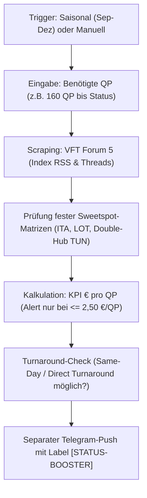

# Miles & More "Status-Booster" Modul: Strategien, Sweetspots & VFT-Quellen

Dieses Dokument bündelt alle Konzepte, Recherchequellen und Systemarchitekturen für ein eigenständiges **Status-Booster-Modul** (für FTL-, Senator- und HON-Circle-Qualifikationen bei Miles & More).

Es dient als Konzeptions- und Umsetzungsvorlage, um gezielte Mileage-Runs und QP-Booster außerhalb des regulären Ferien- und Langstrecken-Alertings abzubilden.

---

## 1. Relevante Primärquellen im Vielfliegertreff (VFT)

Folgende Threads im Vielfliegertreff bilden das Rückgrat der Community-Erkenntnisse und sollten für das Modul als Daten- und Inspirationsquelle dienen:

| Thread | ID | Forum | Thema & Fokus |
| :--- | :---: | :---: | :--- |
| **[Zum HON in 2027: Strategien & Sweetspots](https://www.vielfliegertreff.de/forum/threads/zum-hon-in-2027-strategien-sweetspots.167214/)** | `167214` | Forum 5 | Langstrecken-Runs in C & F, Double-Hubs, Ex-Nordafrika-Routings und Mindestaufenthalt-Tricks |
| **[Qualifying Points Runs für M&M ab 2024](https://www.vielfliegertreff.de/forum/threads/qualifying-points-runs-fuer-m-m-ab-2024.157622/)** | `157622` | Forum 5 | Der zentrale Megathread (89+ Seiten) zu tagesaktuellen QP- und Point-Sweetspots, ITA-Airways-Tarifen und Segment-Booster |
| **[Direct-Turnaround Thread](https://www.vielfliegertreff.de/forum/threads/direct-turnaround-thread.89284/)** | `89284` | Forum 5 | Liste aller europäischen Airports, an denen man ohne erneute Sicherheitskontrolle direkt am Ankunftsgate wieder einsteigen kann |
| **[Mir fehlen noch xxx Punkte zum FTL/SEN/HON](https://www.vielfliegertreff.de/forum/threads/sammelthread-mir-fehlen-noch-xxx-meilen-bis-zum-ftl-sen-hon-im-miles-more-programm.30109/)** | `30109` | Forum 5 | Community-Sammelthread für gezielte Jahresend-Sprints ab bestimmten Heimatflughäfen |
| **[HON Meilenrun 2026 – Ideen / jemand dabei?](https://www.vielfliegertreff.de/forum/threads/hon-meilenrun-2026-ideen-jemand-dabei.164704/)** | `164704` | Forum 5 | Gruppen-Routings und gemeinsame Buchungen für Statusmaximierung |

---

## 2. Punkte-Grundlagen (Miles & More ab 2024/2026)

* **Status-Ziele:**
  * **Frequent Traveller (FTL):** 650 Points, davon mind. **325 Qualifying Points (QP)**
  * **Senator (SEN):** 2.000 Points, davon mind. **1.000 Qualifying Points (QP)**
  * **HON Circle Member:** **6.000 HON Circle Points** (nur in Business und First Class auf voll integrierten Airlines)
* **Punkte pro Flugsegment in Business Class:**
  * **Kontinental (Europa & Nordafrika):** **40 Points** / **40 QP**
  * **Interkontinental (Langstrecke):** **200 Points** / **200 QP** (First Class: **400 Points / QP**)
* **Vollintegrierte Partner (Punkte = QP):**
  Lufthansa (`LH`), Lufthansa City (`VL`), SWISS (`LX`), Austrian (`OS`), Brussels Airlines (`SN`), Eurowings (`EW`), Discover Airlines (`4Y`), Air Dolomiti (`EN`), LOT Polish Airlines (`LO`), ITA Airways (`AZ`), Luxair (`LG`), Croatia Airlines (`OU`).

---

## 3. Die 4 Kern-Sweetspots im Detail

### Sweetspot 1: Der "Ex-Nordafrika Double-Hub Trick" (Langstrecke)
* **Routing-Beispiel:** `TUN (Tunis) ➔ FRA ➔ MUC ➔ WDH (Windhuk)` Return in Business Class
* **Punkte-Ausbeute:** **560 Points & 560 QP / HON-Points**
* **Kosten:** ca. **1.500 € – 1.800 €**
* **QP-Ratio:** **~2,68 € pro QP**
* **Funktionsweise:** 
  Nordafrika (Tunesien, Marokko, Algerien, Ägypten) gilt bei M&M als kontinental (40 QP). Wer über zwei Hubs routet (z.B. FRA und MUC), fliegt pro Richtung 2 Zubringer à 40 QP plus die Langstrecke à 200 QP:
  `(40 + 40 + 200) * 2 = 560 QP`. Das Ganze ist oft an einem einzigen verlängerten Wochenende abfliegbar.

### Sweetspot 2: Der "ITA Airways Inneritalien-Booster" (Kontinental)
* **Routing-Beispiel:** `REG (Reggio Calabria) ➔ FCO (Rom) ➔ TRS (Triest)` Return in Business Class (Buchungsklasse Z)
* **Punkte-Ausbeute:** **160 Points & 160 QP** (4 Segmente à 40 QP)
* **Kosten:** ca. **240 € – 270 €**
* **QP-Ratio:** **~1,59 € pro QP** (Unschlagbarer Bestwert!)
* **Funktionsweise:** 
  ITA Airways (`AZ`) vergibt als vollintegrierter Partner volle QP. Die inneritalienischen Umsteiger via FCO sind extrem günstig und können an einem einzigen Tag ohne Hotelübernachtung abgeflogen werden.

### Sweetspot 3: LOT Polish Airlines (LO) Ex-EU Langstrecke
* **Routing-Beispiel:** `WAW / ARN / BUD ➔ WAW ➔ NRT (Tokio) / BKK (Bangkok) / DEL (Delhi)` Return in C
* **Punkte-Ausbeute:** **400 bis 480 Points & QP** (Boeing 787 Dreamliner Lie-Flat)
* **Kosten:** ca. **1.400 € – 1.700 €**
* **QP-Ratio:** **~3,20 € pro QP**
* **Funktionsweise:** 
  Verbindet hohe QP-Ausbeute mit einem vollwertigen Urlaubs-Langstreckenflug ohne Zickzack-Stress. LOT vergibt als vollintegrierter Partner immer 1:1 Qualifying Points.

### Sweetspot 4: European Direct-Turnaround (Tages-Run ab Basishafen)
* **Routing-Beispiel:** `HAM ➔ FRA ➔ ZAG (Zagreb) ➔ FRA ➔ HAM` an einem Samstag
* **Punkte-Ausbeute:** **160 Points & 160 QP**
* **Kosten:** ca. **450 € – 550 €**
* **QP-Ratio:** **~3,10 € pro QP**
* **Funktionsweise:** 
  Nutzt Flughäfen aus dem *Direct-Turnaround-Thread* (wie ZAG, WAW, PRG), bei denen ankommende Passagiere direkt wieder am Abfluggate stehen. Kein Gepäck, kein Verlassen des Sicherheitsbereichs, keine Hotelkosten.

---

## 4. Konzeption des eigenständigen Moduls (`run_status_booster.py`)

### Warum getrennt vom Haupt-Bot?
Der reguläre Bot (`bot.py`) ist darauf optimiert, komfortable Urlaubs- und Privatreisen ab HAM/Hubs zu finden (max. 1 Umstieg, keine bizarren Positionierungen). Ein Vermischen würde dazu führen, dass der Nutzer im Alltag mit Zickzack-Flügen (z. B. 4 Segmente quer durch Süditalien) überflutet wird.

### Funktionsweise des Booster-Moduls:

### Spezifische Bewertungs-KPIs:
1. **Ratio Euro pro QP (`price_eur / qp`):**
   * `< 2,00 € / QP`: Exzellenter Sweetspot (Sofortalarm, z.B. ITA Italien)
   * `2,00 € – 2,80 € / QP`: Sehr guter Run (z.B. Tunis Double-Hub)
   * `> 3,20 € / QP`: Nur relevant, wenn echtes Urlaubsziel mit hohem Komfort
2. **Zeit-Effizienz:**
   * `same_day_return`: Kann der Run an einem Kalendertag ohne Hotel beendet werden?
   * `weekend_run`: Reicht ein Wochenende (Freitagabend bis Sonntag)?
3. **Turnaround-Sicherheit:**
   * Abgleich des Wendeflughafens mit der *Direct-Turnaround-Datenbank* (verhindert verpasste Rückflüge durch Passkontrollen oder Terminalwechsel).
